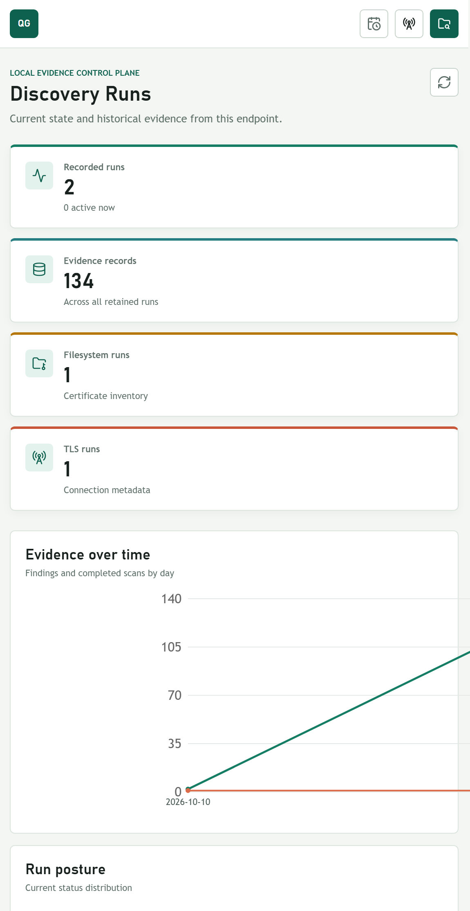
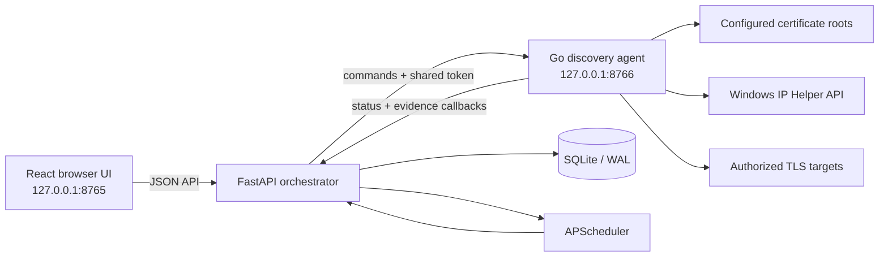

# Genie Discovery

Local certificate inventory and TLS metadata discovery for Windows. The product combines a small Go endpoint agent, a FastAPI orchestration API, SQLite evidence history, and a React reporting interface.



## What is included

- **Discovery Runs:** live state, retained history, status and type trends, duration, record counts, and errors.
- **File System Scan Report:** certificate identity, SANs, cryptographic posture, validity, duplicate locations, parsing evidence, charts, filters, and relationships.
- **TLS Metadata Scan Report:** Windows TCP ownership telemetry plus explicit TLS metadata probes, protocol/cipher/certificate evidence, activity charts, filters, and a weighted relationship graph.
- **Orchestration:** manual scan controls and persisted interval schedules with `Manual` or `Scheduled` trigger attribution.
- **Safety:** loopback-only command surfaces, optional per-start shared token, bounded file reads, no symlink traversal, no payload capture, no decryption, and no private-key collection.

## Architecture



The backend owns run lifecycle, validation, persistence, aggregation, scheduling, and reports. The agent only discovers local evidence and returns structured observations. Repeated observations resolve to stable nodes and increment directed edge weights rather than producing unrelated graph entities.

More detail:

- [Architecture and evidence model](docs/ARCHITECTURE.md)
- [Complete project walkthrough](docs/PROJECT_GUIDE.md)

## Supported environment

| Item | Requirement |
| --- | --- |
| Operating system | Windows 10/11 or Windows Server 2022+ (x64) |
| PowerShell | Windows PowerShell 5.1 or PowerShell 7+ |
| Go | 1.26+ for building the agent |
| Python | 3.11+ |
| Node.js | 20+ with npm |
| Browser | Current Edge, Chrome, or Firefox |

The delivered agent package is Windows-specific. The backend and frontend use portable frameworks, but only the Windows workflow is supported and tested for this submission.

## Quick start

From a PowerShell terminal in the repository root:

```powershell
Set-ExecutionPolicy -Scope Process Bypass
.\scripts\setup.ps1
.\scripts\start.ps1
```

Open **http://127.0.0.1:8765**. Press `Ctrl+C` in the startup terminal to stop both local processes.

The setup script creates `backend/.venv`, installs locked frontend dependencies, builds the production UI, runs tests, builds the agent, packages it, and enforces the 5 MiB package limit.

If `python` is not the required interpreter:

```powershell
.\scripts\setup.ps1 -PythonExecutable "C:\Path\To\python.exe"
```

## Exact commands

| Purpose | Command |
| --- | --- |
| Complete setup | `.\scripts\setup.ps1` |
| Prepare public-only demo evidence | `.\scripts\prepare-demo.ps1` |
| Start all local components | `.\scripts\start.ps1` |
| Run every check | `.\scripts\test.ps1` |
| Build and size-check the agent | `.\scripts\build-agent.ps1` |
| API documentation while running | `http://127.0.0.1:8765/api/docs` |

### Ports and files

| Resource | Default |
| --- | --- |
| Web UI and API | `127.0.0.1:8765` |
| Agent command API | `127.0.0.1:8766` |
| SQLite database | `data/quantumgenie.db` |
| Agent log | `%LOCALAPPDATA%\QuantumGenie\agent.log` |
| Agent package | `agent/dist/quantumgenie-agent-windows-amd64.zip` |

Use `-ApiPort` and `-AgentPort` with `scripts/start.ps1` to change ports. Configuration keys are listed in [.env.example](.env.example).

## Agent package size

The assignment permits an executable **or installable package** no larger than 5 MB. This project submits the compressed Windows package.

| Artifact | Verified size |
| --- | ---: |
| Stripped executable | 7,305,728 bytes (6.97 MiB) |
| Installable ZIP package | **3,037,954 bytes (2.90 MiB)** |
| Enforced limit | 5,242,880 bytes (5 MiB) |

`scripts/build-agent.ps1` fails if the ZIP exceeds the limit. The agent uses only the Go standard library.

## Permissions

A standard Windows user can run the complete workflow. Administrator rights are not required for configured user-accessible roots or active TLS probes.

Run the terminal as Administrator only when the demonstration intentionally scans protected system paths or needs process executable paths hidden from the current user. Inaccessible paths and unavailable process metadata are retained as explicit evidence; the scanner does not attempt privilege escalation.

## Discovery behavior

### Filesystem

The agent scans configured roots for PEM, DER, CRT, CER, PFX/P12, PKCS#7, and JKS extensions. X.509 PEM and DER certificates are parsed. SHA-256 over certificate DER is the stable identity; repeated locations remain visible while being marked as duplicates.

PKCS#12 and Java keystores are detected but not opened because doing so could require credentials or expose private-key material. The report records the container and a clear parsing limitation.

### TLS metadata

The agent combines:

1. Windows IP Helper API snapshots for established TCP ownership on common TLS ports, including PID and executable when accessible.
2. Optional active metadata-only TLS handshakes to user-authorized targets, producing SNI, TLS version, selected cipher suite, and peer certificate metadata.

The active probe deliberately skips trust verification so expired or private-CA peer certificates can still be inventoried. It does not send application payloads after the handshake.

## Testing

```powershell
.\scripts\test.ps1
```

The checks cover Go certificate parsing/deduplication and TLS metadata probing, backend migrations and callback/report workflows, schedule CRUD, Python lint, React/TypeScript compilation, frontend lint, and production bundling.

A live local validation performed for this repository produced:

- 2 certificate location observations, 1 stable certificate identity, and 1 weighted relationship edge.
- A successful TLS 1.3 metadata handshake using `TLS_AES_128_GCM_SHA256` with peer certificate evidence.
- 132 observed TLS events, 32 endpoints, 61 relationship nodes, and 96 directed edges.

Values vary with endpoint activity and are not seeded sample data.

## Assumptions and limitations

- Only systems and traffic the operator is authorized to inspect may be scanned.
- Existing Windows TCP connections reveal process ownership and endpoints, not TLS handshake fields. Protocol, cipher, SNI, and peer certificate fields are available for explicit active probes.
- TCP telemetry samples established connections on recognized TLS ports; short-lived connections between samples may be missed.
- Process paths may be unavailable because of Windows access controls or process termination.
- Password-protected keystores are identified but not opened.
- Files larger than 16 MiB, symlinks, and selected high-risk/system-generated directories are skipped.
- Scheduling runs while the local backend process is active. Schedules persist in SQLite and are restored on restart.
- This is a single-host local product. Authentication, multi-tenancy, fleet management, automatic updates, and cloud deployment are intentionally out of scope.

## Third-party dependencies

- Backend: FastAPI, Uvicorn, aiosqlite, APScheduler, HTTPX, Pydantic Settings, pytest, Ruff.
- Frontend: React, Vite, TypeScript, TanStack Query, React Router, Recharts, React Flow, Lucide.
- Agent: Go standard library only.

Dependencies are pinned by `frontend/package-lock.json` and bounded in `backend/pyproject.toml`.

## AI-assisted development disclosure

GitHub Copilot was used to assist implementation, testing, and documentation. The repository contains no generated evidence presented as live discovery data. All included code and behavior remain reviewable, testable, and modifiable by the submitter.

## Demonstration

Use the concise [five-minute demonstration script](docs/DEMO.md). It covers installation, both manual scan buttons, completed reports, the relationship map, and periodic scheduling in the required order.
