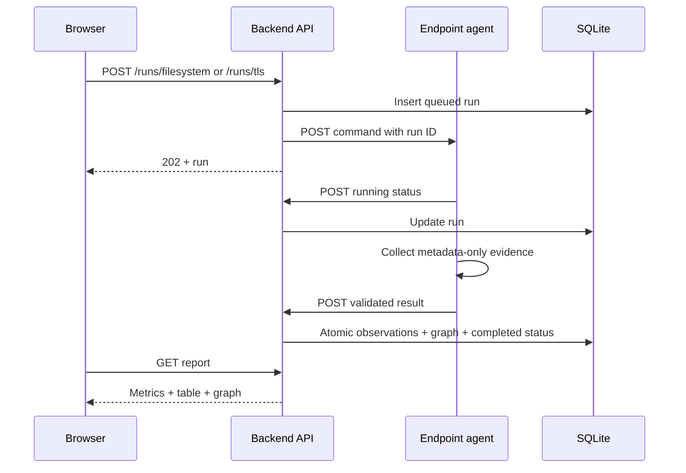
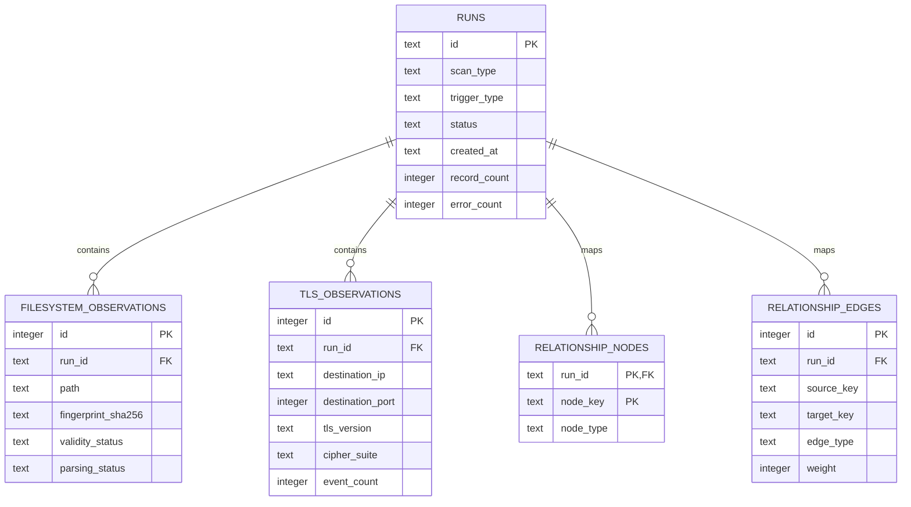

# Architecture and evidence model

## Component boundaries

### Endpoint agent (`agent/`)

- A single Windows executable written in Go.
- Binds only to an explicit loopback address.
- Accepts filesystem and TLS metadata commands asynchronously.
- Reports status and final structured evidence to the backend with bounded retries.
- Writes JSON logs locally and shuts down on `Ctrl+C`/termination.

### Local backend (`backend/`)

- FastAPI owns run identifiers and state transitions: `queued`, `running`, `completed`, `partial`, and `failed`.
- Pydantic rejects unknown or malformed agent fields.
- SQLite runs in WAL mode with foreign keys and versioned SQL migrations.
- Result ingestion is idempotent per run: prior evidence is replaced atomically before a callback is committed.
- APScheduler restores enabled interval schedules from SQLite at startup.
- The built React SPA is served from the same loopback origin.

### Browser interface (`frontend/`)

- TanStack Query polls active local evidence and invalidates views after commands.
- Routes map directly to the three assignment views.
- Recharts visualizes distributions and trends; React Flow renders directed, weighted relationships.
- Large visualization libraries are route-split from the initial bundle.

## Command and callback flow

## Relationship model

Node identities are stable within a run:

- `host:local`
- `process:<SHA-256(pid:name)>`
- `endpoint:<host-or-ip>:<port>`
- `service:<SHA-256(name:port)>`
- `certificate:<DER SHA-256 fingerprint>`

Directed edge types are `stores`, `owns`, `runs`, `communicates_with`, `provides`, `presents`, and `observes`. Repeated evidence increments `weight` and updates `last_seen` on the existing edge.

## Data model

## Security boundaries

- Both listeners default to `127.0.0.1`; the agent refuses non-loopback bind addresses.
- `scripts/start.ps1` creates a fresh in-memory shared token for API-to-agent commands and callbacks unless `QG_AGENT_TOKEN` is supplied.
- HTTP request bodies are size-limited and JSON contracts reject extra fields.
- The filesystem scanner does not follow symlinks and bounds certificate-file reads to 16 MiB.
- Keystore credentials, private keys, TLS payloads, and decrypted content are never requested or retained.
- SQL statements use bound parameters; report grouping expressions are internal constants, not user input.