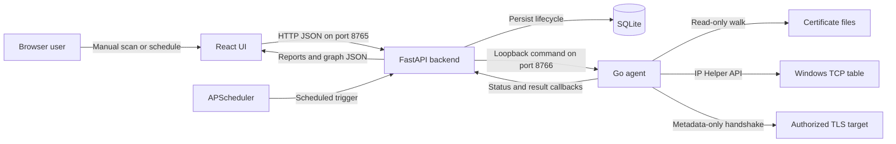
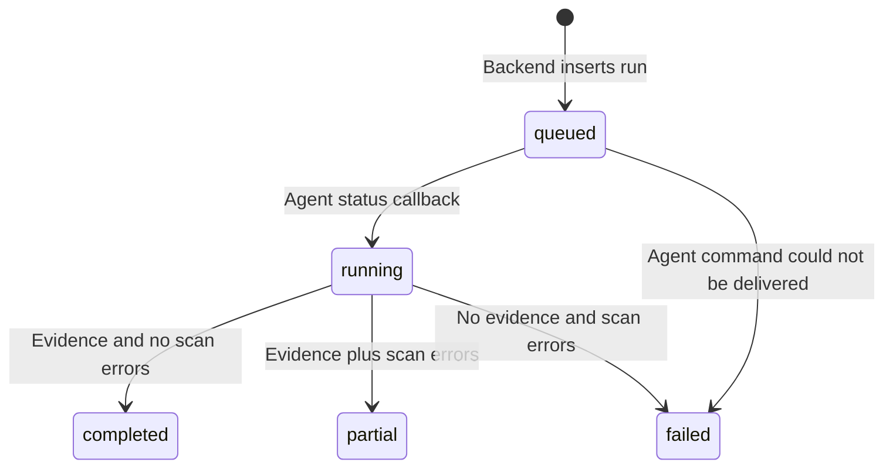
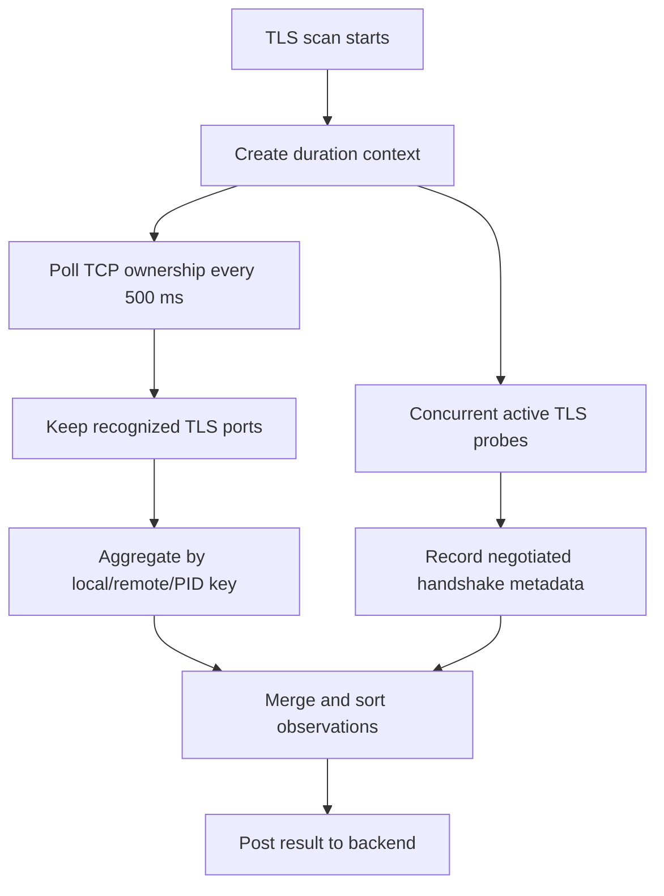

# QuantumGenie Discovery: Complete Project Walkthrough

This document explains the project from its initial folder structure through installation and runtime behavior. It is intended for a reviewer or developer who wants to understand not only how to run the application, but also which file owns each behavior and what happens internally during filesystem discovery, TLS metadata discovery, scheduling, persistence, reporting, and shutdown.

## Coverage index

Folder creation, setup, startup/shutdown, filesystem flow, TLS flow, scheduling, database, API, frontend, relationships, security, logs/errors, tests, demo, troubleshooting, limitations, and command reference.

## 1. Product purpose

QuantumGenie Discovery is a single-host, local cryptographic inventory product for Windows. It has four responsibilities:

1. Find certificate files in authorized filesystem locations.
2. Observe TLS-related connection metadata without capturing payloads.
3. Persist every discovery run and its evidence in SQLite.
4. Present inventories, trends, filters, and relationship graphs in a browser.

The product is intentionally local. It does not include accounts, cloud deployment, multi-host fleet management, credential capture, private-key collection, packet payload capture, or TLS decryption.

## 2. High-level design



### Why these technologies were selected

| Layer | Technology | Reason |
| --- | --- | --- |
| Endpoint agent | Go | Produces one Windows executable, has strong standard-library cryptography and networking support, and compresses below the 5 MiB package requirement. |
| Backend | FastAPI and Pydantic | Provides strict JSON contracts, asynchronous HTTP calls, generated API documentation, and clear service boundaries. |
| Data store | SQLite with WAL | Requires no database server, persists locally, supports transactions, and is sufficient for a single-host product. |
| Scheduler | APScheduler | Provides interval jobs, coalescing, maximum-instance control, and application lifecycle integration. |
| Frontend | React and TypeScript | Provides a typed, interactive local UI with reliable loading and error states. |
| Charts | Recharts | Renders report distributions and trends from backend aggregates. |
| Relationships | React Flow | Renders directed, weighted evidence nodes and edges with zoom and navigation. |

## 3. How the repository was organized

The project starts with one root folder and separate ownership boundaries:

```text
Assignment/
|-- agent/                 Go endpoint agent
|-- backend/               FastAPI API, SQLite access, migrations, tests
|-- frontend/              React and TypeScript browser application
|-- scripts/               Setup, build, run, test, and demo helpers
|-- docs/                  Architecture, demo, and project explanations
|-- data/                  Generated SQLite database and demo evidence
|-- .github/workflows/     Windows continuous-integration workflow
|-- .env.example           Optional runtime configuration
|-- .gitignore             Generated file and secret exclusions
|-- README.md              Reviewer entry point
`-- SECURITY.md            Safe-use and vulnerability guidance
```

### Conceptual folder creation

These commands illustrate how the empty workspace was separated before source files were added. They are not setup commands for an already populated clone.

```powershell
New-Item -ItemType Directory -Force agent, backend, frontend, scripts, docs, data

Set-Location agent
go mod init github.com/quantumgenie/discovery-agent
Set-Location ..

python -m venv backend\.venv
npm create vite@latest frontend -- --template react-ts
```

The important architectural choice is not the command itself. It is that the agent, backend, and frontend remain independent components with explicit HTTP contracts between them.

## 4. Detailed folder and file ownership

### 4.1 Agent

```text
agent/
|-- go.mod
|-- cmd/quantumgenie-agent/main.go
|-- internal/agent/
|   |-- server.go
|   `-- runner.go
|-- internal/discovery/
|   |-- filesystem.go
|   |-- tls.go
|   |-- connections_windows.go
|   |-- connections_other.go
|   |-- filesystem_test.go
|   `-- tls_test.go
|-- internal/model/model.go
`-- dist/                  Generated executable and ZIP package
```

- [`main.go`](../agent/cmd/quantumgenie-agent/main.go) parses command-line settings, rejects non-loopback command addresses, creates JSON logging, starts the HTTP server, and handles graceful shutdown.
- [`server.go`](../agent/internal/agent/server.go) defines `/health`, `/v1/scans/filesystem`, and `/v1/scans/tls`. It validates run IDs, request size, duration, target limits, and the shared token.
- [`runner.go`](../agent/internal/agent/runner.go) starts scans asynchronously, prevents duplicate active run IDs, posts running status, retries final callbacks, computes terminal status, and logs duration and counts.
- [`filesystem.go`](../agent/internal/discovery/filesystem.go) owns certificate file walking, parsing, metadata extraction, validity classification, and fingerprint deduplication.
- [`tls.go`](../agent/internal/discovery/tls.go) owns the timed TLS observation loop, target normalization, active TLS handshakes, event aggregation, and peer certificate metadata.
- [`connections_windows.go`](../agent/internal/discovery/connections_windows.go) calls Windows `GetExtendedTcpTable` and resolves process image paths.
- [`model.go`](../agent/internal/model/model.go) is the JSON contract shared by agent handlers, scanners, and callbacks.

### 4.2 Backend

```text
backend/
|-- pyproject.toml
|-- migrations/001_initial.sql
|-- app/
|   |-- main.py
|   |-- api.py
|   |-- config.py
|   |-- database.py
|   |-- schemas.py
|   `-- services/
|       |-- agent_client.py
|       |-- runs.py
|       |-- relationships.py
|       |-- reports.py
|       `-- scheduler.py
`-- tests/
    |-- conftest.py
    `-- test_api.py
```

- [`main.py`](../backend/app/main.py) creates FastAPI, initializes services during application lifespan, configures CORS, maps exceptions, serves the built SPA, and shuts down the scheduler and HTTP client.
- [`api.py`](../backend/app/api.py) declares the public browser endpoints, private agent callbacks, health endpoint, schedule endpoints, and token verification.
- [`config.py`](../backend/app/config.py) loads `QG_` environment settings and converts configured roots, targets, and origins into lists.
- [`database.py`](../backend/app/database.py) creates SQLite connections, enables foreign keys and WAL mode, applies SQL migrations, and exposes bound-parameter query helpers.
- [`schemas.py`](../backend/app/schemas.py) strictly validates browser commands and agent evidence. Unknown fields are rejected.
- [`agent_client.py`](../backend/app/services/agent_client.py) sends loopback health and scan commands to the agent.
- [`runs.py`](../backend/app/services/runs.py) owns run creation, status transitions, idempotent result ingestion, graph storage, counts, errors, and dashboard aggregates.
- [`relationships.py`](../backend/app/services/relationships.py) converts observations into stable graph nodes and weighted directed edges.
- [`reports.py`](../backend/app/services/reports.py) reads evidence and computes report summaries and chart distributions.
- [`scheduler.py`](../backend/app/services/scheduler.py) persists, restores, enables, disables, deletes, and executes periodic scans.

### 4.3 Frontend

```text
frontend/src/
|-- main.tsx
|-- App.tsx
|-- index.css
|-- lib/
|   |-- api.ts
|   |-- types.ts
|   `-- format.ts
|-- components/
|   |-- Charts.tsx
|   |-- RelationshipGraph.tsx
|   |-- RunsTable.tsx
|   |-- ScanDialog.tsx
|   |-- SchedulesDialog.tsx
|   `-- ui.tsx
`-- pages/
    |-- DashboardPage.tsx
    |-- FilesystemReportPage.tsx
    `-- TLSReportPage.tsx
```

- [`main.tsx`](../frontend/src/main.tsx) installs the React Router and TanStack Query providers.
- [`App.tsx`](../frontend/src/App.tsx) owns navigation, health polling, lazy-loaded routes, scan mutations, schedule modal state, and agent-unavailable messaging.
- [`api.ts`](../frontend/src/lib/api.ts) is the only browser HTTP client and maps typed functions to `/api/v1` endpoints.
- [`types.ts`](../frontend/src/lib/types.ts) mirrors backend response shapes.
- The three files under `pages/` implement the required Discovery Runs, File System Scan Report, and TLS Metadata Scan Report views.
- The reusable components provide charts, graph rendering, filters, dialogs, status chips, metrics, loading, empty, and error states.

### 4.4 Scripts

| Script | Responsibility |
| --- | --- |
| [`setup.ps1`](../scripts/setup.ps1) | Installs dependencies, builds all components, runs checks, packages the agent, and creates the data folder. |
| [`build-agent.ps1`](../scripts/build-agent.ps1) | Tests, strips, builds, compresses, measures, and enforces the 5 MiB agent package limit. |
| [`start.ps1`](../scripts/start.ps1) | Creates runtime environment values, starts the agent, starts Uvicorn, and stops the agent when Uvicorn exits. |
| [`test.ps1`](../scripts/test.ps1) | Runs Go tests, Ruff, pytest, frontend lint, and the production frontend build. |
| [`prepare-demo.ps1`](../scripts/prepare-demo.ps1) | Creates two public certificate files for a safe deduplication demonstration without exporting a private key. |

## 5. Installation from a clean clone

### 5.1 Prerequisites

Install these commands on Windows:

```text
go      Go 1.26 or later
python  Python 3.11 or later
node    Node.js 20 or later
npm     Included with Node.js
```

Confirm them:

```powershell
go version
python --version
node --version
npm --version
```

### 5.2 Run setup

```powershell
Set-Location "C:\Users\v-chkarthik\Downloads\Assignment"
Set-ExecutionPolicy -Scope Process Bypass
.\scripts\setup.ps1
```

### 5.3 What `setup.ps1` does

The setup script performs these steps in order:

1. Resolves the repository root from the script location.
2. Verifies that Python, Go, and npm are available.
3. Creates `backend/.venv` if it does not exist.
4. Upgrades pip inside that isolated environment.
5. Installs `backend/pyproject.toml` in editable mode with development dependencies.
6. Runs `npm ci` from the frontend, using `package-lock.json` for reproducibility.
7. Runs `npm run build`, which type-checks and creates `frontend/dist`.
8. Calls `build-agent.ps1`.
9. Runs the consolidated test script unless `-SkipTests` was supplied.
10. Creates the root `data` directory.

Generated artifacts after setup:

```text
backend/.venv/
frontend/node_modules/
frontend/dist/
agent/dist/quantumgenie-agent.exe
agent/dist/quantumgenie-agent-windows-amd64.zip
data/
```

These generated directories are excluded from Git where appropriate.

## 6. Application startup and shutdown

### 6.1 Start

```powershell
.\scripts\start.ps1
```

Optional ports:

```powershell
.\scripts\start.ps1 -ApiPort 8875 -AgentPort 8876
```

### 6.2 What `start.ps1` does

1. Verifies that the backend virtual environment and production frontend build exist.
2. Builds the agent if its executable is missing.
3. Creates a random `QG_AGENT_TOKEN` unless one is already set.
4. forces the API host to `127.0.0.1`.
5. Configures the backend's agent URL from the selected agent port.
6. Defaults the SQLite path to `data/quantumgenie.db`.
7. Starts the Go agent as a child process with loopback command and callback URLs.
8. Starts Uvicorn in the foreground.
9. When Uvicorn exits, the `finally` block stops the agent process.

Expected startup output:

```text
QuantumGenie Discovery: http://127.0.0.1:8765
agent listening ... 127.0.0.1:8766
Uvicorn running on http://127.0.0.1:8765
```

Open `http://127.0.0.1:8765`.

### 6.3 Backend lifespan startup

When Uvicorn imports the app, the FastAPI lifespan function:

1. Creates the `Database` object.
2. Applies unapplied files from `backend/migrations`.
3. Creates the agent HTTP client.
4. Creates run, report, and schedule services.
5. Stores those services under `app.state` for route handlers.
6. Starts APScheduler.
7. Reloads enabled schedules from SQLite.

### 6.4 Stop

Press `Ctrl+C` in the startup terminal. Uvicorn closes, the backend scheduler shuts down, the backend HTTP client closes, and `start.ps1` terminates the child agent.

## 7. Shared runtime configuration

Configuration uses environment variables with the `QG_` prefix.

| Variable | Default | Purpose |
| --- | --- | --- |
| `QG_API_HOST` | `127.0.0.1` | Backend bind address. |
| `QG_API_PORT` | `8765` | UI and API port. |
| `QG_AGENT_URL` | `http://127.0.0.1:8766` | Backend-to-agent command URL. |
| `QG_AGENT_TOKEN` | Generated by `start.ps1` | Shared local command and callback token. |
| `QG_DATABASE_PATH` | `data/quantumgenie.db` | SQLite evidence database. |
| `QG_DEFAULT_SCAN_ROOTS` | Empty | Semicolon-separated default certificate roots. |
| `QG_DEFAULT_TLS_DURATION_SECONDS` | `15` | Default TLS observation period. |
| `QG_DEFAULT_PROBE_TARGETS` | Empty | Comma-separated default TLS targets. |

## 8. Run lifecycle used by both scan types

Every manual or scheduled scan uses the same lifecycle:



Each run stores:

- A 32-character UUID-style ID.
- Scan type: `filesystem` or `tls`.
- Trigger: `manual` or `scheduled`.
- Start, completion, and duration timestamps.
- Status and status message.
- Record, unique, and error counts.
- Error summary.
- Effective scan configuration.
- Agent version.
- Evidence source.

The frontend polls run and report endpoints while the application is open, so queued and running state changes become visible without a page refresh.

## 9. Filesystem scan flow: complete internal flow

### 9.1 User command

The user selects **Filesystem scan**, enters up to 32 roots, and selects **Start scan**.

The frontend sends:

```http
POST /api/v1/runs/filesystem
Content-Type: application/json

{
  "roots": ["C:\\authorized\\certificates"]
}
```

### 9.2 Backend orchestration

`RunService.start_filesystem`:

1. Uses submitted roots or configured defaults.
2. Generates a run ID.
3. inserts a `queued` row in `runs` before contacting the agent.
4. Sends the run ID and roots to `POST http://127.0.0.1:8766/v1/scans/filesystem`.
5. Marks the run failed with `Agent unavailable` if command delivery fails.
6. Returns the persisted run immediately with HTTP `202 Accepted`.

Persisting first guarantees that the browser can display the run even if the agent is offline.

### 9.3 Agent command acceptance

The agent server:

1. Validates the optional shared token in constant time.
2. Limits the body to 1 MiB.
3. Rejects unknown JSON fields.
4. Validates the run ID and root count.
5. Reserves the run ID in an in-memory active-run map.
6. Starts discovery in a goroutine and returns `202 Accepted` immediately.

### 9.4 Status callback

The runner sends:

```http
POST /api/v1/agent/runs/{run_id}/status

{
  "status": "running",
  "timestamp": "...",
  "message": "filesystem discovery started"
}
```

The backend records `started_at` only if it is not already present.

### 9.5 Root handling

The scanner:

1. Expands environment variables such as `%USERPROFILE%`.
2. Removes blank roots.
3. Converts roots to absolute, cleaned paths.
4. Deduplicates roots case-insensitively.
5. Uses standard certificate locations when no roots are supplied.

Windows defaults include user and system certificate directories derived from `ProgramData`, `APPDATA`, and `USERPROFILE`.

### 9.6 Directory walking and safety

The scanner uses `filepath.WalkDir` and:

- Never writes to source files.
- Does not follow symlinks.
- Skips `$Recycle.Bin`, `System Volume Information`, `node_modules`, and `.git` subtrees.
- Captures access errors rather than aborting all other roots.
- Stops when the parent context is cancelled.
- Reads only recognized extensions.
- Refuses certificate files larger than 16 MiB.

Recognized extensions:

```text
.pem .der .crt .cer .pfx .p12 .p7b .p7c .jks
```

### 9.7 Parsing behavior

PEM files can contain multiple certificate blocks. DER/CRT/CER bytes are parsed with Go's X.509 parser.

For safety:

- PFX/P12 is detected but not opened because it may contain password-protected private keys.
- PKCS#7 is recorded as detected but unsupported by this lightweight build.
- JKS is recorded without requesting a keystore credential.
- Invalid files become `parse_failed` evidence instead of disappearing.
- Unreadable files become `access_error` evidence.

### 9.8 Extracted certificate evidence

For every parsed certificate, the agent records:

- Full path, filename, format, root, and discovery time.
- SHA-256 fingerprint over raw DER.
- Serial number, subject, issuer, and SAN entries.
- Chain position for multi-certificate files.
- Public-key algorithm and key size.
- Signature algorithm.
- Valid-from and valid-to timestamps.
- Integer days to expiry.
- `valid`, `expiring`, `expired`, or `not_yet_valid` posture.
- Parsing status and confidence.

The default `expiring` window is 30 days.

### 9.9 Deduplication

The first path for a fingerprint becomes the canonical observation for the run. Later observations with the same fingerprint retain their own path but receive:

```text
duplicate = true
duplicate_of = <first path>
```

This design preserves location evidence while counting one cryptographic identity.

### 9.10 Result callback and transaction

The runner computes:

- `completed` when no scan-level errors occurred.
- `partial` when records exist but scan-level errors occurred.
- `failed` when no records exist and scan-level errors occurred.

It posts to `/api/v1/agent/results/filesystem`. Delivery retries occur immediately, then after 500 ms, 1.5 seconds, and 3 seconds.

The backend validates the full payload, checks that the run type matches, and opens one transaction. Inside that transaction it:

1. Deletes prior evidence for that run, making repeated callbacks idempotent.
2. Inserts every filesystem observation.
3. Creates relationship nodes and edges.
4. Computes total and unique fingerprint counts.
5. Updates status, duration, counts, errors, and agent version.
6. Commits all evidence together.

### 9.11 Filesystem relationships

At minimum:

```text
local host --stores--> certificate
process    --owns----> certificate   when ownership is known
```

Repeated certificate locations increase the `stores` edge weight.

### 9.12 Filesystem report

`ReportService.filesystem` returns:

- Total and unique certificates.
- Valid, expiring, expired, and parse-failed counts.
- Duplicate observation count.
- Validity, algorithm, key-size, issuer, and location distributions.
- Full observation table.
- Directed relationship graph.

The React page adds client-side search and validity/parsing filters.

## 10. TLS scan flow: complete internal flow

### 10.1 User command

The user selects **TLS scan**, supplies an observation duration and up to 32 authorized targets, and starts the scan.

```http
POST /api/v1/runs/tls
Content-Type: application/json

{
  "duration_seconds": 15,
  "probe_targets": ["example.com:443"]
}
```

The backend creates the run first, then calls the agent's `/v1/scans/tls` command. The same queued, running, partial, completed, and failed lifecycle applies.

### 10.2 Duration and target normalization

The backend schema permits 1 to 300 seconds. The agent also defensively clamps the duration to the same practical range of 1 second through 5 minutes.

Targets:

- Are trimmed and deduplicated case-insensitively.
- Can be `host`, `host:port`, or a URL.
- Default to port 443 when no port is provided.
- Must contain a valid port from 1 through 65535.

### 10.3 Two evidence methods run together

The scanner starts active target probes in goroutines while also sampling the Windows connection table every 500 ms.



### 10.4 Windows connection telemetry

`connections_windows.go` calls `GetExtendedTcpTable` for IPv4 and IPv6 with owner PID information. It keeps established connections and resolves the executable path with `QueryFullProcessImageNameW` when Windows permissions allow it.

Recognized default TLS-related ports are:

```text
443 HTTPS
465 SMTPS
636 LDAPS
853 DNS over TLS
993 IMAPS
995 POP3S
8443 HTTPS alternate
8883 MQTTS
9443 HTTPS alternate
```

Direction is inferred from whether the known TLS service port is local or remote. Each repeated snapshot increments `event_count` on the same connection key:

```text
local IP + local port + remote IP + remote port + PID
```

This method can provide endpoint and process ownership, but an operating-system TCP table cannot reveal historical handshake fields. Therefore its observations honestly use:

```text
capture_method = windows_ip_helper_api
handshake_outcome = not_visible_in_tcp_table
evidence_confidence = medium
```

### 10.5 Active metadata probe

For each explicit target, the agent performs a TLS handshake with a five-second dial timeout. It records:

- Local and remote IP and port.
- Outbound direction and TCP transport.
- Hostname and SNI when the target is a hostname.
- Negotiated TLS version.
- Selected cipher suite.
- Agent PID, process name, and executable.
- Peer certificate SHA-256 fingerprint.
- Peer subject, issuer, expiry, and validity posture.
- Success or failure and error text.

The TLS configuration uses `InsecureSkipVerify` intentionally for discovery. This allows inventory of expired, private-CA, and otherwise untrusted peer certificates. It does not mean payload traffic is trusted or sent: the agent completes only the metadata handshake and closes the connection.

### 10.6 Event totals

An active probe contributes one event. A Windows connection observation increments every time the same connection is seen during polling. The report's event total is the sum of all `event_count` values, so every total can be explained by stored rows.

### 10.7 TLS result ingestion

The agent posts observations to `/api/v1/agent/results/tls`. The backend transaction:

1. Clears prior evidence for the same run.
2. Inserts endpoint, process, protocol, cipher, certificate, method, confidence, and event-count fields.
3. Counts unique endpoint and port combinations.
4. Builds relationship nodes and weighted edges.
5. Sets run duration and terminal status.
6. Commits atomically.

### 10.8 TLS relationship model

Depending on available evidence, the graph contains:

```text
host        --runs--------------> process
host/process --communicates_with-> endpoint
endpoint    --provides-----------> service
endpoint    --presents-----------> certificate
host/process --observes----------> certificate
```

Node identities use stable keys derived from host, process, endpoint, service, or certificate fingerprint. Repeated events add to edge weight and update `last_seen`.

### 10.9 TLS report

The backend returns:

- Sum of observed events.
- Unique endpoints and ports.
- Peer certificates observed.
- Successful handshakes and evidence errors.
- Number of mapped relationships.
- TLS-version, cipher-suite, endpoint, certificate-posture, and activity distributions.
- Full observation table and relationship graph.

The frontend adds endpoint/process/cipher/certificate search, TLS-version filters, and outcome filters.

## 11. Scheduling service

The calendar control uses these endpoints:

```text
GET    /api/v1/schedules
POST   /api/v1/schedules
PATCH  /api/v1/schedules/{id}
DELETE /api/v1/schedules/{id}
```

When a schedule is created:

1. The request is validated as filesystem or TLS configuration.
2. A schedule row is inserted with interval, enabled state, and JSON configuration.
3. APScheduler registers an `IntervalTrigger` in UTC.
4. The next-run timestamp is written immediately to SQLite.
5. `coalesce=True` prevents a burst of missed executions.
6. `max_instances=1` prevents the same schedule from overlapping itself.

When the trigger fires, the service calls the same `RunService` method as a manual scan but passes `trigger="scheduled"`. No mock or alternate collection path is used.

Enabled schedules are restored during backend startup. Pausing removes the in-memory job but retains its row. Deleting removes both.

## 12. Database and migrations

The database is created automatically at `data/quantumgenie.db` unless configured otherwise.

Every connection enables:

```sql
PRAGMA foreign_keys = ON;
PRAGMA journal_mode = WAL;
PRAGMA busy_timeout = 5000;
```

Migration `001_initial.sql` creates:

| Table | Purpose |
| --- | --- |
| `schema_migrations` | Records applied SQL migration versions. |
| `runs` | Stores lifecycle, trigger, counts, configuration, errors, and timing. |
| `filesystem_observations` | Stores one row per certificate location and chain position. |
| `tls_observations` | Stores connection and handshake evidence with event counts. |
| `relationship_nodes` | Stores typed graph entities per run. |
| `relationship_edges` | Stores directed weighted relationships per run. |
| `schedules` | Stores persistent interval scan definitions and timestamps. |

Foreign-key cascading removes dependent evidence when a run is deleted. Indexes support run history, fingerprints, validity, endpoints, protocol versions, graph edges, and enabled schedules.

## 13. API surface

### Browser-facing endpoints

| Method and path | Purpose |
| --- | --- |
| `GET /api/v1/health` | API, database, and agent health. |
| `GET /api/v1/config` | Safe defaults for dialogs. |
| `GET /api/v1/dashboard` | Overview totals and trend distributions. |
| `GET /api/v1/runs` | Filtered run history. |
| `GET /api/v1/runs/{id}` | One run. |
| `POST /api/v1/runs/filesystem` | Start a manual filesystem scan. |
| `POST /api/v1/runs/tls` | Start a manual TLS scan. |
| `GET /api/v1/reports/filesystem/{id}` | Certificate report. |
| `GET /api/v1/reports/tls/{id}` | TLS report. |
| `GET /api/v1/runs/{id}/graph` | Relationship graph only. |
| Schedule endpoints | Create, list, pause/resume, and delete schedules. |

### Agent callback endpoints

| Method and path | Purpose |
| --- | --- |
| `POST /api/v1/agent/runs/{id}/status` | Mark an accepted run as running. |
| `POST /api/v1/agent/results/filesystem` | Submit certificate evidence. |
| `POST /api/v1/agent/results/tls` | Submit TLS evidence. |

When a shared token is configured, callbacks require `X-Agent-Token`. Comparison is constant-time.

Interactive OpenAPI documentation is available at `http://127.0.0.1:8765/api/docs` while the app is running.

## 14. Frontend runtime behavior

### Health and configuration

`App.tsx` polls health every five seconds. The header displays API and agent indicators. If FastAPI is available but the agent is not, the UI keeps report access working and displays an explicit agent-unavailable banner.

### Starting a scan

The scan dialog sends a TanStack Query mutation. On success, the frontend:

1. Invalidates dashboard and run-history queries.
2. Closes the dialog.
3. Navigates to `/filesystem/{run_id}` or `/tls/{run_id}`.
4. Polls the report while the agent works.

### Routes

```text
/                         Discovery Runs
/filesystem/{run_id}      File System Scan Report
/tls/{run_id}             TLS Metadata Scan Report
```

Routes are lazy-loaded so large chart and graph libraries do not inflate the initial bundle. The backend's SPA static-file handler returns `index.html` for direct report-route refreshes.

### Required UI states

Reusable components provide:

- Loading spinners.
- Empty-state messages.
- API error evidence.
- Queued, running, completed, partial, and failed chips.
- Agent connectivity warning.
- Responsive tables and dialogs.

## 15. Relationship evidence rules

Relationships are derived from evidence rather than entered manually.

### Stable entities

- Certificate: DER SHA-256 fingerprint.
- Endpoint: hostname or IP plus port.
- Process: hash of PID and process name/executable identity.
- Service: hash of service name and port.
- Host: fixed local-host identity for the run.

### Repetition

The in-memory relationship builder uses `(source, target, edge type)` as its edge key. When the same evidence appears again, it:

1. Adds to `weight`.
2. Preserves `first_seen`.
3. Updates `last_seen`.
4. Avoids creating an unrelated duplicate edge.

## 16. Security and privacy behavior

- Agent and backend bind to loopback by default.
- The agent refuses a non-loopback command bind address.
- A fresh shared token protects agent commands and callbacks during scripted startup.
- Pydantic rejects extra JSON fields.
- Agent request bodies are limited to 1 MiB.
- SQL values use bound parameters.
- Filesystem reads are bounded and read-only.
- Symlinks are not followed.
- Keystore passwords are not requested.
- Private keys are not copied or exported.
- TLS application payloads are not sent after the discovery handshake.
- Existing traffic payloads are not captured or decrypted.
- Process paths that Windows denies are left unavailable rather than bypassing permissions.

## 17. Logs and errors

The agent writes JSON logs to:

```text
%LOCALAPPDATA%\QuantumGenie\agent.log
```

Each completion log includes run ID, terminal status, record count, error count, and duration.

Common failures remain visible:

| Failure | Result |
| --- | --- |
| Agent is offline | Backend persists a failed run with `Agent unavailable`. |
| Some roots are inaccessible | Accessible evidence is retained and run can become `partial`. |
| All roots fail with no evidence | Run becomes `failed`. |
| Certificate cannot parse | Observation remains with `parse_failed`. |
| Target handshake fails | TLS observation remains with error and failed outcome. |
| Process path is protected | PID may remain while executable is unavailable. |
| Final callback temporarily fails | Agent retries callback with bounded backoff. |

## 18. Tests and validation

Run all checks:

```powershell
.\scripts\test.ps1
```

The script performs:

1. `go test ./...` for certificate parsing, deduplication, protected containers, TLS probing, and target parsing.
2. Ruff checks for backend source and tests.
3. pytest integration tests against a temporary migrated SQLite database.
4. Frontend Oxlint.
5. TypeScript compilation and Vite production build.

Build and enforce the package limit separately:

```powershell
.\scripts\build-agent.ps1
```

The Windows GitHub Actions workflow runs the same setup and validation and uploads the agent ZIP artifact.

## 19. Safe demonstration workflow

Generate public-only demo evidence:

```powershell
.\scripts\prepare-demo.ps1
```

It creates:

```text
data/demo-certs/quantumgenie-demo.cer
data/demo-certs/quantumgenie-demo-copy.pem
```

Both files contain the same public certificate, so a scan produces two observations and one unique fingerprint. The helper does not export a private key.

The complete five-minute recording sequence is in [DEMO.md](DEMO.md).

## 20. Troubleshooting

### Setup says a command is missing

Run `Get-Command go`, `Get-Command python`, and `Get-Command npm`. Install or add the missing tool to `PATH`, then rerun setup.

### API port is already in use

```powershell
.\scripts\start.ps1 -ApiPort 8875 -AgentPort 8876
```

Open `http://127.0.0.1:8875`.

### API is green but agent is red

Stop the current terminal with `Ctrl+C`, confirm `agent/dist/quantumgenie-agent.exe` exists, and rerun `start.ps1`. Review `%LOCALAPPDATA%\QuantumGenie\agent.log` if it remains unavailable.

### Filesystem report is empty

- Confirm the root is an existing absolute path.
- Confirm files use recognized extensions.
- Check run errors for access failures.
- Use `prepare-demo.ps1` to verify the known demonstration path.

### TLS report lacks cipher or certificate fields

Rows from Windows TCP telemetry cannot expose handshake history. Add an authorized explicit probe target to obtain negotiated metadata.

### Changes do not appear in the browser

The backend serves `frontend/dist`, not development source. Rebuild:

```powershell
Set-Location frontend
npm run build
Set-Location ..
```

Then restart the application.

### Database needs a clean local reset

Stop the application first, then remove only generated data:

```powershell
Remove-Item .\data\quantumgenie.db* -Force -ErrorAction SilentlyContinue
```

The next startup recreates and migrates the database. This permanently removes prior local run history.

## 21. Known limitations

- Windows is the supported and tested agent platform.
- TCP telemetry samples connections and can miss very short-lived sessions between polls.
- Existing TCP-table rows cannot reveal prior TLS handshake fields.
- Active probes inventory peer certificates without validating trust.
- Password-protected keystores are detected but not opened.
- Scheduling runs only while the local backend is active, though definitions persist across restart.
- This is a single-host application, not a production fleet manager.
- Local HTTP is acceptable because both services are loopback-only; remote exposure is unsupported.

## 22. End-to-end command reference

```powershell
# Enter the repository
Set-Location "C:\Users\v-chkarthik\Downloads\Assignment"

# Permit local scripts in this terminal only
Set-ExecutionPolicy -Scope Process Bypass

# Install, build, test, and package
.\scripts\setup.ps1

# Optional safe certificate evidence
.\scripts\prepare-demo.ps1

# Start agent, backend, scheduler, SQLite, and UI
.\scripts\start.ps1

# Open the application
Start-Process "http://127.0.0.1:8765"

# In another terminal, rerun all checks when required
.\scripts\test.ps1
```

The complete execution path is now:

```text
folder structure
  -> dependency setup
  -> production builds
  -> agent packaging
  -> database migration
  -> local services start
  -> manual or scheduled command
  -> agent discovery
  -> authenticated callback
  -> atomic SQLite persistence
  -> report aggregation
  -> charts, filters, and relationship graph
```